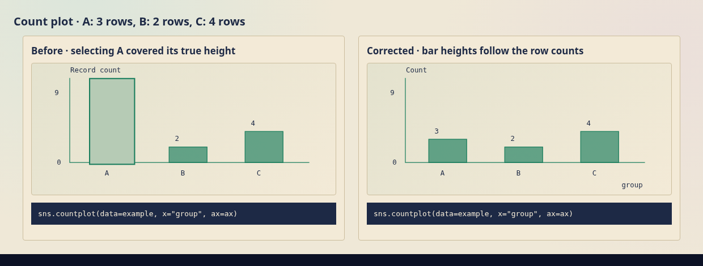

# Code-linked visual corrections

The count illustration drew a full-height filled selection rectangle over the
correct bar. Its stored counts were A=3, B=2 and C=4, but selecting A or B covered
those heights. Earlier checks verified the counts and missed the extra geometry.
The overlay is removed, and regression checks now inspect every filled rectangle
against the visible observations and independently executed Seaborn output.

This comparison renders the previous and current SVG implementations with the
shared stylesheet. The [full lesson evidence](curriculum-evidence/code-linked-visuals/)
comes from the actual built pages.

## Controls and teaching

Every active control now changes executable Python. A selection that only
highlights an existing mark is insufficient. Observations remain fixed when
comparing an operation or parameter, and the result follows its calculation.

| Lesson | Current interaction |
| --- | --- |
| V08 · category counts | Change the counted column between `group` and `shift`. Counts are 3/2/4 and 5/4 respectively, with a common zero baseline and scale. |
| V16 · scatter | Swap x/y or choose `cost` for x while retaining `value` for y. The call, labels and all nine point coordinates update together. |
| V11 · boxplot | Switch the numeric value axis. Both orientations retain the calculated quartiles, whiskers and outlier. |
| V26 · scales | Switch linear/log x spacing for the same positive observations. |
| V29 · exact bars | Compare the supplied heights from grouped mean, sum or median; retain the common scale. |
| I13L · extreme labels | Change the numeric column in `idxmax()`. Show the returned original row label alongside the maximum and its numbered position. |
| W01 · working copy | Change the selected columns in `clean`; show the preserved source beside the result. |
| W14 · dates | Change the parsing format; matching text parses and other values become `NaT`. |
| ML-W07 · imputation | Compare mean/median replacements on asymmetric numeric data. Only the missing cell changes. |
| ML-C08 Change · neighbours | Change the query coordinates in Python. Keep k=5, the fitted scale and training observations fixed; recompute neighbours and votes. |
| ML-U07 · Ward hierarchy | Compare original/standardised coordinates using the corresponding native Ward fit. |
| ML-P01 · PCA | Change `n_components` between one and two; update output dimensions, coordinates and retained variance. |
| ML-N02 · loss history | Retain an accurate static history; remove the iteration-highlighting control. |

Existing useful controls remain, including bin counts, smoothing, categorical
encoding, jitter, marker size, intervals, stacking, model settings and prediction
inputs. Static illustrations remain where the current operation has no useful
variable to change. For example, reading `shape`, column labels or dtypes does
not need a new control. Duplicate policies remain in their authored later stage.
Threshold selection is not added to the ML-C07 Follow illustration: that task
first computes out-of-fold probabilities.

ML card thumbnails now use actual example geometry for scaling, neighbour votes,
centroids, fitted polynomial curves and neural loss/performance. Sampling shows
sampled identities instead of an unrelated fitted hierarchy. Count/summary card
heights agree with their illustrative observations.

## Concision and existing behaviour

Illustrations use the short label **Illustrative data**. Removed repeated row
counts, “separate from the exercise” suffixes, duplicate titles/captions and
unnecessary assurances about unchanged data. Essential distinctions such as
training versus validation, units, SD, and probability versus decision scores
remain. Actual exercise data retain their own dataset labels.

Follow/Change/Transfer placement, concise new-task teaching, semantic identifier
styles and independent desktop reading/editor scrolling remain. No learning
state is saved. The 338 Data exercises, 338 ML exercises, their data, solutions,
requirements and grading contracts are unchanged from `64c2909`; all 19 ML
independent challenges are unchanged. The [contract comparison](curriculum-evidence/code-linked-visuals/contracts.json)
records the permitted presentation changes.

## Validation and review

The [validation receipt](curriculum-evidence/code-linked-visuals/validation.json)
records commands, build identity, source hashes and exact coverage. The checks
include actual lesson controls, rendered geometry, independent native operations,
keyboard access, both themes, phone layouts and real browser Python execution.
The new AST check rejects controls whose Python differs only in comments,
formatting or highlighting. Native geometry checks include extra/occluding
rectangles rather than trusting a renderer's data model alone.

- All 676 activities: 4,056 lesson views at 1440/390/320 pixels in both themes,
  and 1,386 option states across the 92 active control contexts.
- Native pandas/sklearn checks for all 47 table-operation examples and 106
  states; native plot-artist/SVG comparisons for 15 bar, scatter, scale and box
  states; existing independent statistical and model-family oracles.
- Distinct Python ASTs for 251 states across 97 registered control helpers,
  including helpers currently unused by a lesson.
- 85 ML concepts, 110 card thumbnails, 280 concept captures, four fitted browser
  Python figures, plus isolated preview navigation and Data/ML Python grading.

The final `npm run check` passed. Exercise-contract comparison, editor/scroll
checks, catalog contrast/geometry and visual-source fingerprints also passed.

A final one-line label clarification prevents the ML query's `y` coordinate
from inheriting target-variable styling. The [inverse source comparison](curriculum-evidence/code-linked-visuals/final-label-delta.json)
proves that no calculation, geometry, option value or Python changed. Another
114 actual views and 108 option states cover the clarification at all six
width/theme combinations; the full-sweep and follow-up build IDs remain recorded.

Review the [examples gallery](curriculum-evidence/code-linked-visuals/examples/),
desktop/mobile Visualise contact sheets and refreshed
[ML contact sheets](ml-learning-visuals/). Automated coverage checks every lesson;
manual inspection used the captures and selected full-size views. These checks
provide evidence, not a guarantee that every teaching choice is optimal.
Safari on a physical device has not been independently tested in this environment.

The [downloadable preview instructions](curriculum-evidence/review-refinement/preview-download.md)
cover both curricula. This remains a review branch: no merge or deployment.
