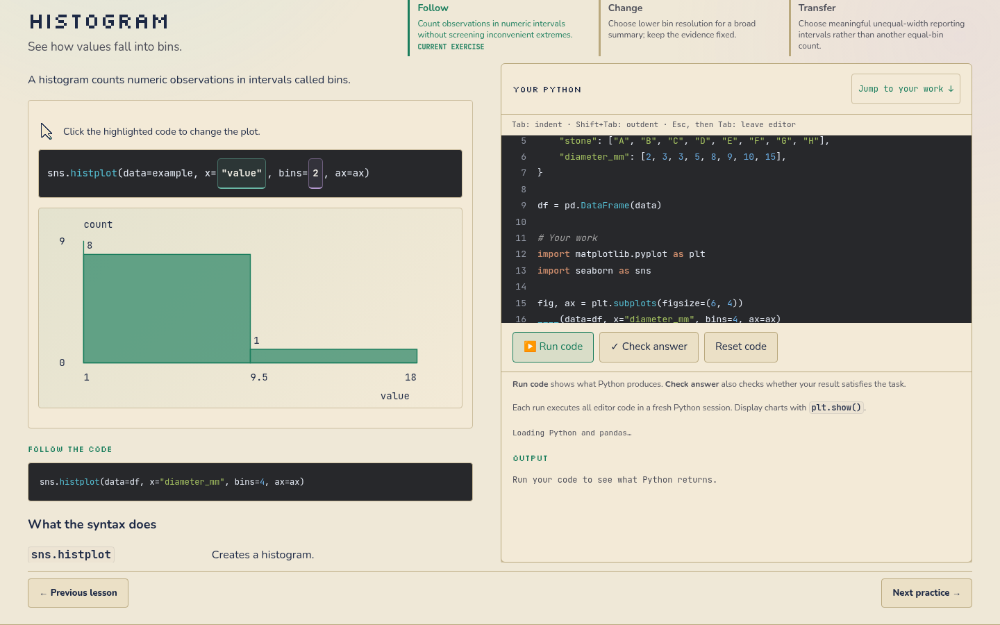
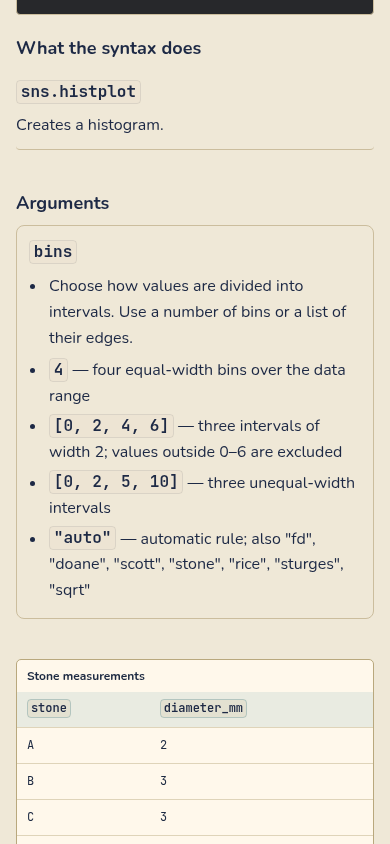
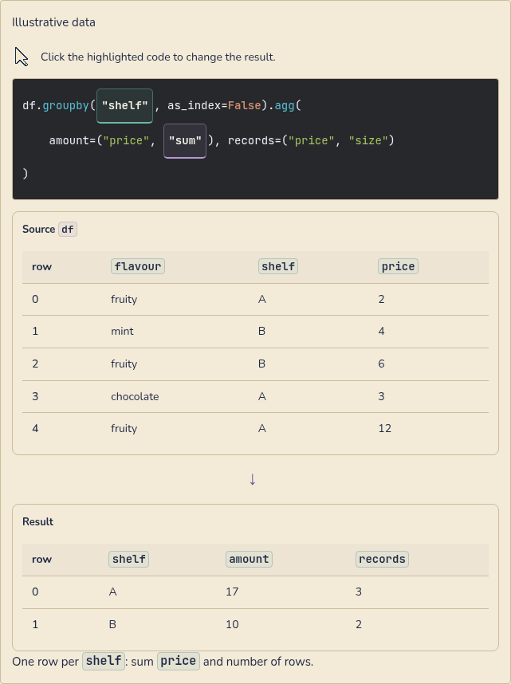

# Illustrative geometry and lesson presentation

This refinement fixes the histogram baseline, simplifies API descriptions, removes
extra illustrative tables from Visualise, and makes teaching tables, argument
explanations and identifiers easier to read. It follows the
[clickable-code work](curriculum-inline-code-controls.md) and preserves the current
curriculum, exercise contracts, colours, Follow/Change/Transfer and independent
desktop reading/editor panes. The branch remains a review candidate; no merge or
deployment is included.

## Changes and their purpose

- **Histogram geometry:** the axis previously ended at SVG y=175 while the bars
  ended at y=190. The axis, zero label and bars now share the correct baseline.
  Count and explicit-edge choices use the same observations and native Seaborn
  results; unequal intervals retain proportionate widths.
- **Visualise introductions:** removed the illustrative dataset table and repeated
  result paragraph. The editable Python and plot remain, with an accessible SVG
  description. The actual exercise dataframe still follows syntax and arguments,
  followed by the task. Static chart introductions no longer append an extra
  evidence table.
- **Direct descriptions:** `sns.lineplot` says “Creates a line plot.” and
  `sns.histplot` says “Creates a histogram.” Shared descriptions cover the other
  Seaborn APIs and simple pandas calls. ML explanations are shorter while keeping
  essential distinctions, such as training-only fitting and population standard
  deviation. Accepted forms, examples and scientific conditions remain visible.
- **Organized arguments:** meanings and accepted values appear as bullet points in
  aligned rows, with matching code/body sizing. Phone rows stack naturally.
- **Quiet identifiers:** columns, variables and syntax share one restrained shape,
  with subtle role colours instead of competing double/dotted borders. Editable
  code keeps distinct colours, visible focus and 44px targets.
- **Readable table illustrations:** source and result flow at full reading width
  with a down arrow. Ten remaining small SVG table introductions now use semantic
  HTML tables rather than shrinking the entire scene. Duplicate illustration code
  is removed. Series alignment shows two separate inputs and their correctly
  aligned result; dtype and duplicate examples preserve their actual values.
- **Stable menus:** Floating UI owns placement, flipping and viewport constraints
  for code choices. It does not own selected values or scientific calculations.
  Long expressions wrap within the reading pane, fixing the 320px overflow found
  in two scaling lessons.

The uploaded **Visual Learning Sites** skill was used for source study, native table
composition, explicit package ownership, rendered geometry collection and acceptance
evidence. The [repair contract](curriculum-evidence/visual-polish/qa/lesson-contract.json)
records the inspected MLU sources and package jobs. This is a targeted enhancement
of the established site, not a framework or navigation rewrite. The uploaded skill
itself is kept outside the public repository.

## Verification

Evidence lives in [visual-polish/](curriculum-evidence/visual-polish/validation.json).
These are different checks with distinct scopes, not one inflated test count:

| Check | Observed scope |
| --- | --- |
| Rendered SVG bounds | 6,024 plot/model states across 1440, 390 and 320px, both themes; actual mark and label bounds, histogram baselines and count scale |
| Native scientific comparisons | 458 chart combinations and 129 model combinations, including explicit/unequal bin edges and actual plotted coordinates |
| Native table calculations | 159 operation states across 47 lessons, plus all 10 rewritten static examples |
| Full activity layout | All 676 Data/ML activities across three widths and both themes: 4,056 contexts |
| Table layout and enlarged text | 466 contexts, including all 57 introductory Inspect/Wrangle table lessons and selected enlarged-text/long-expression cases |
| Combined code choices | 48 contexts: independent values, conditional fields, menu bounds, keyboard focus, contrast and matching typography |
| Visualise reading journey | 37 Follow lessons, 148 views and 516 interactive states |
| ML visual inventory | 85 concepts, 65 primitive/variant families, 110 thumbnails, 19 collection tiles, 280 captures and four real fitted figures |
| Skill acceptance | 82 declared checks; actual geometry reports and direct review of 30 scene/state/viewport screenshots |
| Exercise preservation | All 338 Data round fields/datasets, 338 ML executable contracts and 19 workflow contracts match `5cec626` |

The earlier full layout receipt is retained as `before-width-repair.json`; it found
the long-expression overflow. The final `stages/rendering.json` records the complete
recheck. The Visualise and independent-editor receipts precede that small wrapping
repair; their content IDs remain recorded rather than being relabelled as final.
The current full layout, table and combined-menu checks cover the repaired rules.
The 6,024-state geometry test renders the shared models in a real lesson plot
container; the full activity sweep separately checks their individual lesson
contexts. It does not claim every argument combination was exercised through every
lesson's menu.

Build, JavaScript, route, app-shell, curriculum, Python formatting and scientific
checks passed. The new model tests compare the printed Python with native pandas,
Seaborn and sklearn; screenshot appearance alone is not treated as numerical proof.
The skill validator checks declared evidence and completeness, not scientific truth
or visual quality; those were reviewed separately.

Chromium was used here. WebKit and a physical Mac were not tested. Wide plots retain
the existing labelled local horizontal pan on phones; the page itself does not
overflow. The geometry collector certifies the measured desktop subsections, while
the separate SVG test checks every full plot's coordinate bounds on all widths.

## Review and preview

Read [the full-code review handoff](model-review-handoff.md), including the cumulative
changes since the original baseline. The latest repair adds
`app/code-menu-position.js`, the shared syntax descriptions, native table examples
and their scientific/browser tests to the review scope.

The [downloadable preview](curriculum-evidence/review-refinement/preview-download.md)
contains both curricula. Its package receipt identifies the clean source commit,
build content ID and exact tested HTML/archive hashes. Python execution still needs
internet access for the pinned runtime packages.

### Rendered examples

